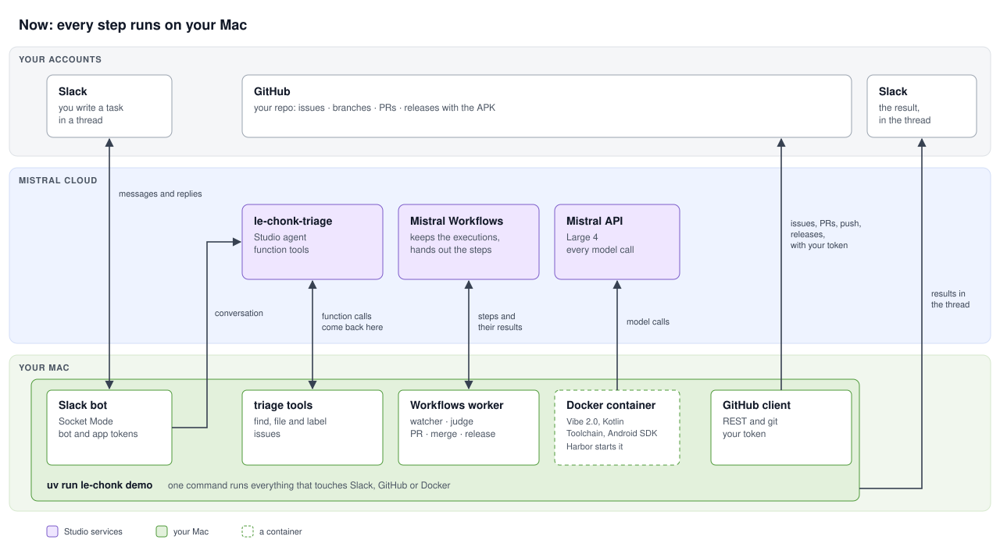
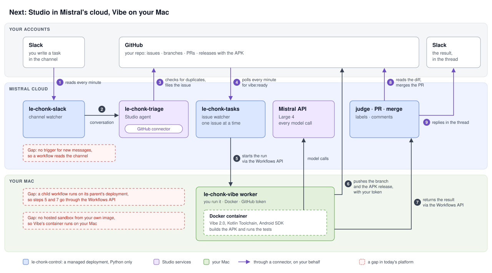

# Architecture

What runs where: the demo as built, then the next phase, built in `src/le_chonk_eval/next/` and set up with
[next.md](next.md).

## Now

`uv run le-chonk demo` runs every step that touches Slack, GitHub or Docker. Mistral's cloud keeps the
triage agent, the workflow executions and the models:

- The triage agent's tools are function tools, so each call comes back to your Mac, which runs it with your
  GitHub token ([friction 18](../FRICTIONS.md#the-demo)).
- Mistral Workflows keeps the executions of `le-chonk-issues`, `le-chonk-issue-run` and `le-chonk-issue-ab`,
  and the worker on your Mac runs their steps.
- Harbor starts Vibe's container, and Vibe calls the Mistral API from there with your key
  ([friction 21](../FRICTIONS.md#the-demo)).

## Next

Everything but Vibe runs in Mistral's cloud, and Studio's connectors do the Slack and GitHub steps on your
behalf: the cloud holds no token. Two deployments share the work:

- `le-chonk-control`, a managed deployment, Python only: `le-chonk-slack` reads the channel and runs the
  triage agent; `le-chonk-tasks` watches the issues, then makes the PR, judges and merges it.
- `le-chonk-vibe`, a worker you run on your Mac: Harbor and Vibe in Docker, then the push and the APK release
  with your GitHub token.

The numbers in the picture are the steps of one task. An A/B takes the same path, with k runs per arm on
your Mac, judged there.

The design works around three gaps:

- Studio and Workflows have no trigger for a Slack message or a GitHub issue ([friction 19](../FRICTIONS.md#the-demo)),
  so both watchers read through the connectors every minute.
- A child workflow runs on its parent's deployment ([friction 22](../FRICTIONS.md#the-demo)), so
  `le-chonk-tasks` starts the Mac's runs, and gets their results, through the Workflows API.
- There's no hosted sandbox built from your own image ([friction 20](../FRICTIONS.md#the-demo)), so Vibe's
  container stays on your Mac.

The connectors sign in as you, so the agent's Slack replies post as you, marked 🤖, and the GitHub steps show
your name ([friction 23](../FRICTIONS.md#the-demo)). Connectors, managed deployments and on-behalf-of workflows
are public previews.

To see what your account has for it: `uv run python scripts/check_next.py`. It only reads, and saves its report
to `runs/check-next.txt`.
